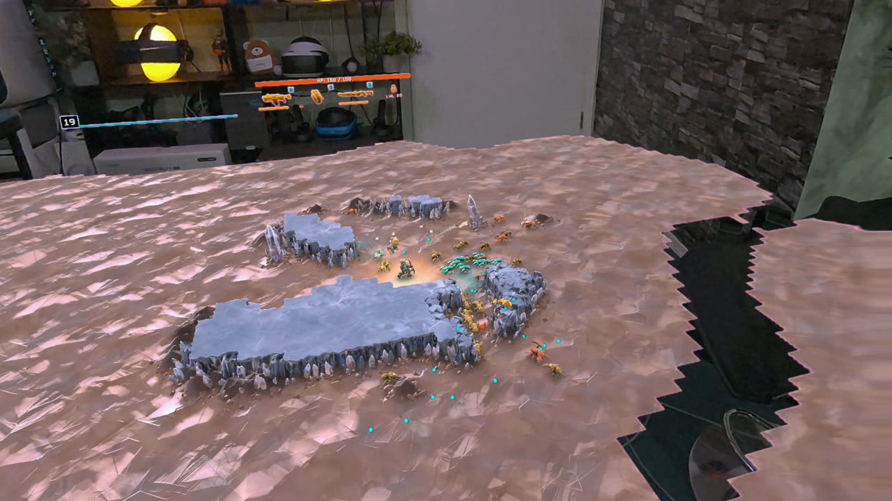
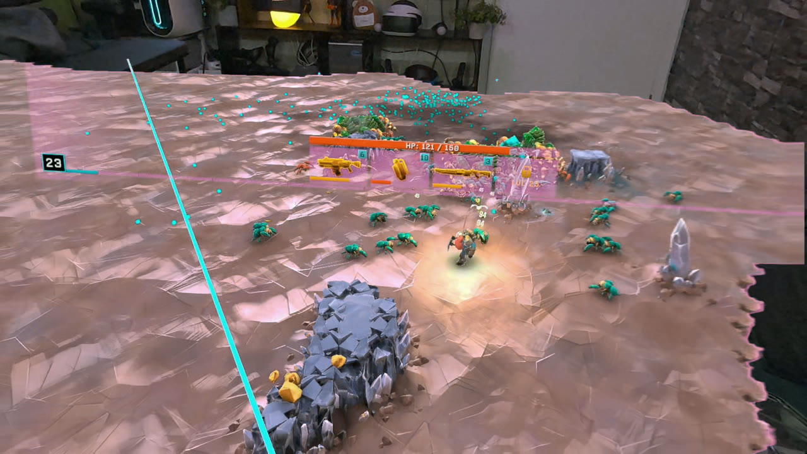
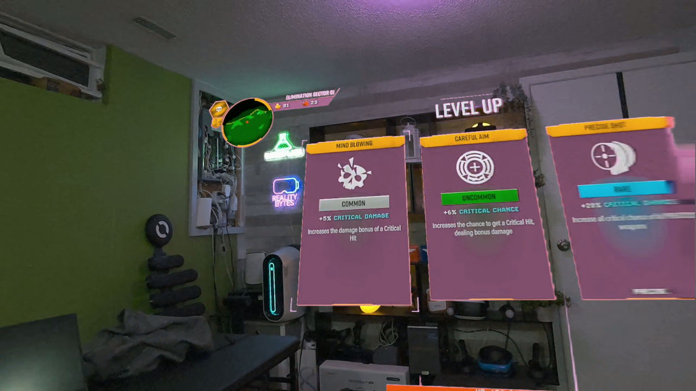

# DRG: Survivor - Mixed Reality

Play **Deep Rock Galactic: Survivor** as a 3D board on your real table, in a Meta Quest 3 with passthrough. The whole map sits in your room, the dwarf runs on the controller, and the upgrade screens float on a big panel you can grab, move and resize.

This is an unofficial fan prototype for the PC (Steam) version. It is not made or endorsed by Funday Games or Ghost Ship Publishing.

## Download

Get the latest zip from **[Releases](https://github.com/LamplighterVR/drg-survivor-mr/releases/latest)**.

## What you need

- Deep Rock Galactic: Survivor on Steam (PC, Windows)
- A Meta Quest 3
- One of:
  - **Meta Quest Link** (cable or Air Link), or
  - **Virtual Desktop** (this route can also record video in the headset)

Built and tested on game build 23854500. A game update can break the mod.

## Install

1. In Steam, right-click the game > **Manage** > **Browse local files**.
2. Copy everything in the zip into that folder (next to `DRG Survivor.exe`).
3. Start once from either "Play MR" file. The first launch takes a few minutes while the mod loader sets itself up. It downloads some Unity files, so be online. Later starts are quick.

### Quest Link

- Your Meta account needs developer mode (free, at developers.meta.com).
- In the Meta Horizon Link PC app: **Settings > Beta**, turn on **Developer Runtime Features** and **Passthrough over Meta Quest Link**. Restart the Link app.
- Connect Link in the headset, then double-click `Play MR (Quest Link).bat`.

### Virtual Desktop

- Connect with Virtual Desktop.
- In Virtual Desktop's Streaming settings, turn **VR Passthrough** on and set the key color to **R 255, G 0, B 255** (magenta). If purple edges show, raise Similarity a little.
- Double-click `Play MR (Virtual Desktop).bat`.
- To record: hold the Meta button and press the right trigger.

## Controls

| Input | Action |
|---|---|
| Left stick | Move the dwarf. Weapons fire by themselves. |
| A / B / X / Y, Menu | Work like a gamepad (A selects in menus) |
| Grip (not pointed at the screen) | Grab the board. One hand moves and turns it, two hands resize it. |
| Point at the game screen + grip | Move the screen. Grip with the other hand too and pull apart to resize it. |
| Right stick click | Put the board back in front of you |

If a menu doesn't respond in the headset, start the run from the monitor.

## Settings

`BepInEx\config\com.lamplightervr.drgsurvivormr.cfg` is created after the first start (board size, height, distance and more). Edit it with the game closed.

## Uninstall

Delete these from the game folder: `BepInEx`, `dotnet`, `winhttp.dll`, `doorstop_config.ini`, `.doorstop_version`, `changelog.txt`, `Play-MR.ps1`, both "Play MR" .bat files and `DRG-MR-README.txt`. No game files are changed.

While the mod is installed, launching from Steam also starts it (using Quest Link). To play the normal game without uninstalling, rename `winhttp.dll` to `winhttp.dll.off`, and rename it back to play in MR again.

## Known issues

- Frame rate dips in busy runs (about 55-65 fps instead of 72).
- Some menus only respond on the monitor.
- This is a prototype and has only been tested on one PC.

## Included third-party software

The zip bundles these, each under its own license:

- [BepInEx](https://github.com/BepInEx/BepInEx) (LGPL-2.1)
- [UnityDoorstop](https://github.com/NeighTools/UnityDoorstop) (LGPL-2.1)
- [Il2CppInterop](https://github.com/BepInEx/Il2CppInterop) (LGPL-3.0)
- [TerraFX.Interop.Windows](https://github.com/terrafx/terrafx.interop.windows) (MIT)
- [OpenXR loader](https://github.com/KhronosGroup/OpenXR-SDK) (Apache-2.0)
- [.NET runtime](https://github.com/dotnet/runtime) (MIT)

Rock and stone.
